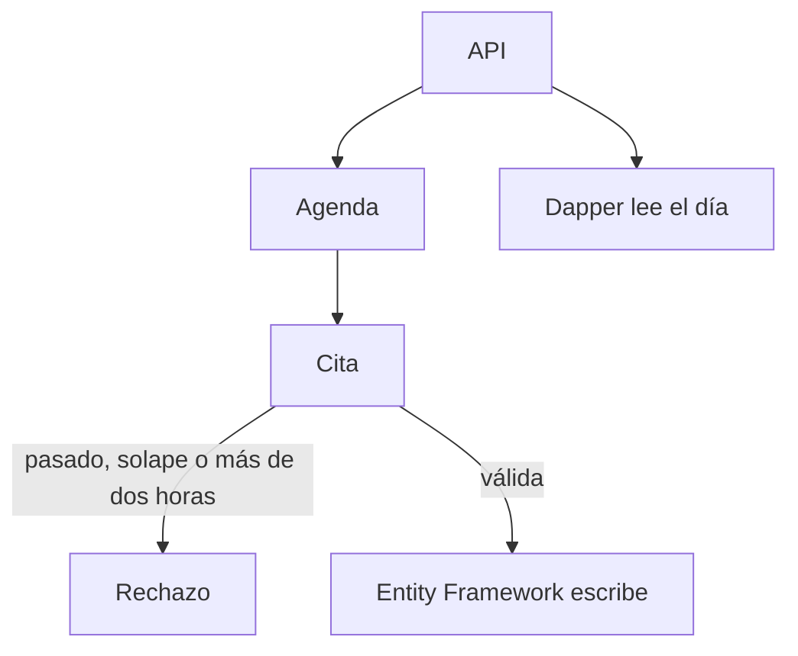

# Consultorio Norte

La agenda de un consultorio. Una cita no empieza en el pasado, no se pisa con otra del mismo médico y no dura más de dos horas.

## Concepto

El paciente entra con un documento de 8 a 12 dígitos. La cita es el agregado: el dominio rechaza el solape antes de tocar la base. Entity Framework guarda ese agregado. Dapper lee las citas del día, la consulta de la recepción.

## Stack

| Pieza | Para qué |
| --- | --- |
| ASP.NET Core | API y Swagger. |
| Clean Architecture | Dominio, aplicación, infraestructura y API en proyectos separados. |
| Domain-Driven Design | `Cita` protege sus invariantes. |
| SOLID | La agenda depende de puertos, no de EF ni de Dapper. |
| Entity Framework Core | Escritura del agregado en SQLite. |
| Dapper | Lectura del día. |
| xUnit | Reglas de agenda y un recorrido de persistencia. |

## Flujo



## Correr

Desde esta carpeta:

```bash
dotnet test
dotnet run --project Consultorio.Api
```

Swagger queda en `/swagger`. En desarrollo el API usa `http://localhost:5143`.
